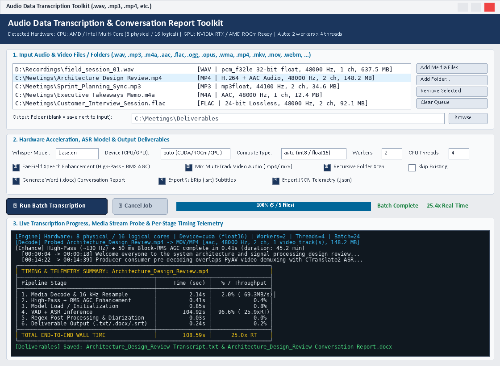
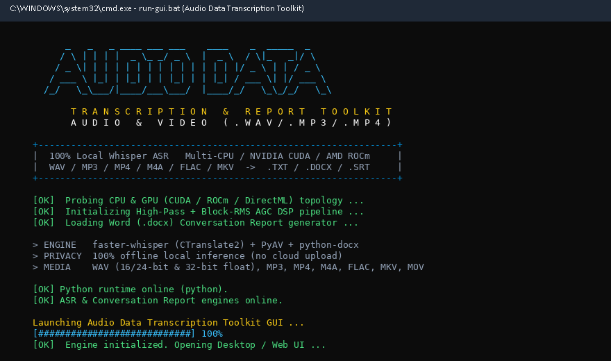

# Audio Data Transcription Toolkit

> **About:** A tool for making audio transcriptions and report summaries off audio recordings from audio (`.wav`, `.mp3`, `.mp4`, etc.) recordings.

A 100% local, privacy-preserving, multi-core CPU and GPU-accelerated (**NVIDIA CUDA**, **AMD ROCm / HIP**, and **Windows DirectML**) audio and video transcription toolkit. Designed for uncompressed and broadcast `.wav` recordings (16-bit, 24-bit, and 32-bit float) as well as standard meeting video and audio formats (`.mp3`, `.mp4`, `.m4a`, `.aac`, `.flac`, `.ogg`, `.opus`, `.wma`, `.mkv`, `.mov`, `.webm`, `.avi`), it provides far-field speech enhancement (Automatic Gain Control), stage-by-stage timing telemetry, plain-text (`.txt`) & subtitle (`.srt`) transcripts, and automated Microsoft Word (`.docx`) Executive Conversation Summary Reports.



---

## Quick Start: Download ZIP & Double-Click `run-gui.bat` (No Git or Admin Needed)

**Not a developer?** On Windows 11 without Git, Conda, or administrator privileges, follow [docs/WINDOWS_11_NO_ADMIN_README.md](docs/WINDOWS_11_NO_ADMIN_README.md):
1. Install **Python 3.12 or 3.13** from the Microsoft Store.
2. Click **Code → Download ZIP** on GitHub and extract the folder.
3. Double-click **`run-gui.bat`** (or run `./run-gui.sh` on Linux/macOS).

Double-clicking `run-gui.bat` opens the startup console below, verifies your Python runtime and dependencies (`faster-whisper`, `python-docx`, `av`, `numpy`, `lxml`), and launches the Desktop GUI:



---

## 1. Supported Audio & Video File Formats

Through PyAV's bundled FFmpeg libraries (`libavformat`, `libavcodec`, `libswresample`), the toolkit natively decodes and resamples both audio recordings and video containers into 16 kHz mono float32 streams without requiring an external `ffmpeg` binary install:

| Category | Extensions Supported | Codec & Container Handling Details |
| :--- | :--- | :--- |
| **Uncompressed / Broadcast Audio** | `.wav`, `.aiff`, `.aif`, `.caf` | Supports 16-bit PCM, 24-bit PCM, and **32-bit IEEE Float (`pcm_f32le`) Broadcast Wave (BWF)** field recorders (including automatic `NaN`/`Inf` float sanitization). |
| **Compressed Audio** | `.mp3`, `.m4a`, `.aac`, `.flac`, `.ogg`, `.opus`, `.wma`, `.amr` | Resilient packet decoding skips isolated corrupt frames mid-stream rather than aborting multi-hour jobs. |
| **Video Containers** | `.mp4`, `.mkv`, `.mov`, `.webm`, `.avi`, `.mpeg`, `.mpg`, `.m4v`, `.ts`, `.3gp`, `.wmv` | Automatically demuxes and extracts the embedded audio track(s). Pass `--mix-streams` (or check **Mix Multi-Track Video Audio** in the GUI) to mix multi-track video recordings (e.g., separate mic + system audio tracks in OBS/Zoom `.mp4`/`.mkv` files). |

---

## 2. Running via the Graphical User Interface (GUI)

### Option A — One-Click Launcher (`run-gui.bat` / `run-gui.sh`)
- **Windows:** Double-click `run-gui.bat` in File Explorer (or run `python gui.py` in Terminal).
- **Linux / macOS / WSL2:** Run `./run-gui.sh` (or `python3 gui.py`).

### Option B — Installed CLI Entry Point (`audio-transcribe-gui`)
```bash
# Launch native Desktop GUI (tkinter/ttk)
audio-transcribe-gui

# Pre-populate the queue with specific files or a directory
audio-transcribe-gui ./recordings/meeting.mp4 ./recordings/voice_memo.mp3
```

### Option C — Built-In Local Browser Web GUI (`--web`)
For headless servers, remote SSH sessions, or browser-based workflows, launch the zero-dependency Web GUI on `http://127.0.0.1:8765`:
```bash
python gui.py --web --port 8765
# Or via entry point:
audio-transcribe-gui --web --port 8765
```

---

## 3. Running on CPU & GPU Variants (Installation & Hardware Acceleration)

### A. Multi-Core CPU Execution (Default Out-of-the-Box)
```bash
pip install -r requirements.txt
pip install -e .
```
- Automatically probes physical vs. logical CPU cores (`detect_hardware_profile()`) and partitions cores across parallel CTranslate2 workers (`--workers`) and intra-op OpenMP threads (`--threads`, capped at 2–8 per worker to prevent OpenMP barrier contention).
- For long recordings ($\ge 4\text{ minutes}$) when `workers > 1` on CPU, the engine splits the audio array at quiet 100 ms energy minima and dispatches chunks in parallel across all workers.

```bash
# Auto-tuned multi-worker CPU execution:
python main.py ./recordings/ --recursive --device cpu --compute-type int8 --enhance --docx

# Explicit 4 workers x 4 threads/worker (16 physical cores):
python main.py ./recordings/ --device cpu --workers 4 --threads 4 --batch-size 16 --enhance --docx
```

### B. NVIDIA CUDA GPU Acceleration (`--device cuda`)
`faster-whisper` (`ctranslate2`) supports NVIDIA CUDA out of the box when NVIDIA drivers and CUDA/cuBLAS runtime libraries are installed:
```bash
# Auto-detects NVIDIA GPU via CTranslate2 / nvidia-smi and selects int8_float16 or float16:
python main.py ./recordings/meeting.mp4 --device cuda --compute-type float16 --batch-size 24 --enhance --docx
```

### C. AMD ROCm / HIP GPU Acceleration on Linux (`--device rocm`)
Supports AMD Instinct and Radeon GPUs on Linux via ROCm-compiled CTranslate2 or the built-in HuggingFace PyTorch ROCm fallback pipeline:
```bash
# Install PyTorch for ROCm + optional transformers pipeline dependencies:
pip install torch --index-url https://download.pytorch.org/whl/rocm6.0
pip install -e ".[amd-rocm]"

# Run on AMD ROCm GPU:
python main.py ./recordings/meeting.wav --device rocm --compute-type float16 --enhance --docx
```

### D. AMD / Intel GPU Acceleration on Windows via DirectML (`--device directml`)
```bash
pip install -e ".[directml]"
python main.py ./recordings/meeting.mp3 --device directml --enhance --docx
```

### E. Probe Hardware & Media Metadata from CLI
```bash
# Display detected CPU cores, NVIDIA CUDA / AMD ROCm / DirectML GPUs, and auto-tuned settings:
python main.py --probe-hardware

# Inspect container format, audio codec, sample rate, channel count, and video tracks:
python main.py --probe-media ./recordings/meeting.mp4 ./recordings/clip.mp3
```

---

## 4. Programmatic Python API Usage

### A. Scalable Batch Transcription (`TranscriberEngine`)
Use `TranscriberEngine` to load the Whisper model **once** in memory and process any combination of `.wav`, `.mp3`, `.mp4`, `.m4a`, `.flac`, or `.mkv` files with background producer-consumer pre-decoding:

```python
from audio_transcriber import TranscriberEngine, detect_hardware_profile

# 1. Inspect detected hardware profile
hw = detect_hardware_profile()
print(hw.summary_line())

# 2. Initialize stateful engine (loads ASR weights once across the entire batch)
engine = TranscriberEngine(
    model_size="base.en",           # "tiny.en", "base.en", "small.en", "medium.en", "large-v3-turbo"
    device="auto",                  # "auto", "cpu", "cuda", "rocm", "directml"
    compute_type="auto",            # "auto", "int8", "float16", "int8_float16", "float32"
    enhance_speech=True,            # O(1)-memory High-Pass (~130 Hz) + 50 ms Block-RMS AGC
    mix_all_audio_streams=False,    # Set True to mix multi-track audio in .mp4/.mkv videos
)

# 3. Transcribe a single file or batch of files/directories
summary = engine.transcribe_batch(
    inputs=["./recordings/session1.wav", "./recordings/design_review.mp4", "./recordings/memo.mp3"],
    output_dir="./deliverables",
    generate_docx=True,             # Generates <stem>-Conversation-Report.docx
    generate_srt=True,              # Generates <stem>.srt subtitles
    generate_json=True,             # Generates <stem>-Telemetry.json
    telemetry_json_path="./deliverables/batch_benchmark.json",
)

# 4. Print aggregate timing & throughput table
print(summary.format_summary_table())
for result in summary.results:
    print(f"Transcript: {result.transcript_txt_path}")
    print(f"Word Report: {result.docx_path}")
    print(f"Speedup: {result.timings.speedup_x_rt:.1f}x RT (RTF={result.timings.rtf:.4f})")
```

### B. Custom Word (`.docx`) Conversation Reports (`MeetingReportBuilder`)
See [examples/custom_conversation_report_example.py](examples/custom_conversation_report_example.py) for building tailored executive summaries with metadata tables, callout boxes, chronological topic breakdowns, and action item tables:

```python
from audio_transcriber import MeetingReportBuilder

builder = MeetingReportBuilder()
builder.add_title("System Architecture & Signal Processing Sync")
builder.add_subtitle("Executive Conversation Summary & Action Items")
builder.add_metadata_table([
    ("Duration & Format", "00:45:12 | MP4 [aac, 48000 Hz, 2 ch]"),
    ("Participants", "Engineering & Product Architecture Team"),
])
builder.add_h1("1. Key Takeaways")
builder.add_callout("High-pass filtering + 50 ms block-RMS AGC boosts far-field voices with <8 MB RAM.", "CORE TAKEAWAY")
builder.add_bullet("Action item tracking and chronological dialogue blocks.", bold_prefix="[00:05:12] ")
builder.save("Architecture-Sync-Report.docx")
```

---

## 5. Per-Stage Timing & Telemetry Output

Every CLI, GUI, and Python API run outputs a structured 6-stage timing breakdown and aggregate batch summary:

```text
┌──────────────────────────────────────────────────────────────────────────────┐
│ TIMING & TELEMETRY SUMMARY: Architecture_Design_Review.mp4                   │
├──────────────────────────────────────────┬────────────────┬──────────────────┤
│ Pipeline Stage                           │     Time (sec) │   % / Throughput │
├──────────────────────────────────────────┼────────────────┼──────────────────┤
│ 1. Media Decode & 16 kHz Resample        │          2.14s │   2.0% ( 69.3MB/s)│
│ 2. High-Pass + RMS AGC Enhancement       │          0.41s │             0.4% │
│ 3. Model Load / Initialization           │          0.85s │             0.8% │
│ 4. VAD + ASR Inference                   │        104.92s │  96.6% ( 25.9xRT)│
│ 5. Regex Post-Processing & Diarization   │          0.03s │             0.0% │
│ 6. Deliverable Output (.txt/.docx/.srt)  │          0.24s │             0.2% │
├──────────────────────────────────────────┼────────────────┼──────────────────┤
│ TOTAL END-TO-END WALL TIME               │        108.59s │      25.0x RT    │
├──────────────────────────────────────────┴────────────────┴──────────────────┤
│ Media: MP4 [aac, 48000 Hz, 2 ch, 1 video track(s), 148.2 MB]                 │
│ Audio Duration: 00:45:12 (2712.4s) | RTF: 0.0400 | Segs: 318 | Words: 6,842  │
└──────────────────────────────────────────────────────────────────────────────┘
```

---

## 6. Complete CLI Reference (`python main.py` or `audio-transcribe`)

| Flag | Description |
| :--- | :--- |
| `inputs` | One or more audio/video files (`.wav`, `.mp3`, `.mp4`, `.m4a`, `.aac`, `.flac`, `.ogg`, `.opus`, `.wma`, `.mkv`, `.mov`, `.webm`, `.avi`), directories, or glob patterns |
| `-d`, `--output-dir` | Output directory for generated deliverables (defaults to each input file's directory) |
| `-o`, `--output-txt` | Explicit `.txt` transcript output path (single-file mode) |
| `-r`, `--recursive` | Recursively scan input directories for supported audio and video files |
| `--skip-existing` | Skip recordings whose `<stem>-Transcript.txt` already exists |
| `--model` | Whisper model (`tiny.en`, `base.en` [default], `small.en`, `medium.en`, `large-v3-turbo`) |
| `--device` | Hardware target: `auto` (default), `cpu`, `cuda` (NVIDIA), `rocm` (AMD Linux), `directml` (AMD/Intel Windows) |
| `--compute-type` | Precision: `auto` (default), `int8`, `float16`, `int8_float16`, `float32` |
| `--workers` | Number of parallel CTranslate2 execution workers (`num_workers`, default: auto from CPU/GPU topology) |
| `--threads` | Number of intra-op CPU threads per worker (`cpu_threads`, default: auto from physical cores) |
| `--batch-size` | Batch size for `BatchedInferencePipeline` (default: `16` on CPU, `24` on GPU) |
| `--enhance` | Enable $O(1)$-memory High-Pass (~130 Hz) + 50 ms Block-RMS AGC for across-table / far-field voices |
| `--mix-streams` | Mix all audio tracks when transcribing multi-track video containers (`.mp4`, `.mkv`) |
| `--docx` | Auto-generate a formatted Word (`.docx`) Conversation Report and timing summary per file |
| `--srt` | Export SubRip (`.srt`) timestamps subtitle file per recording |
| `--json` | Export per-file structured JSON transcript and stage timing breakdown |
| `--telemetry-json` | Export aggregate batch timing benchmark JSON across all recordings |
| `--replacements-json` | Path to a JSON file containing custom regex terminology replacement rules |
| `--probe-hardware` | Print detected CPU/GPU hardware profile and exit |
| `--probe-media` | Inspect container format, codec, sample rate, channels, and duration of input files and exit |
| `--gui` / `--web` | Launch Desktop GUI (`--gui`) or Local Browser Web GUI (`--web --port 8765`) |
